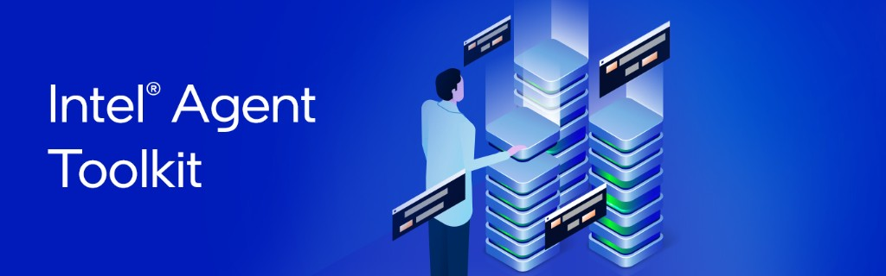

<!-- vale off (due to hyperlinks) -->
[](https://github.com/intel/agent-toolkit/blob/main/LICENSE)
[](https://www.intel.com/xeon)
[](https://www.intel.com/content/www/us/en/products/details/discrete-gpus.html)
[](https://kubernetes.io)
[](https://litellm.ai)
[](https://github.com/intel/agent-toolkit)
<!-- vale on -->

# Intel® Agent Toolkit

**Quickly deploy a production-ready, open source agentic AI stack.**

> An agentic AI stack with an API gateway, inference routing, agent memory, sandboxed code execution, and observability. Toolkit Manager installs these pieces for you.

---

Teams that want **production AI agents** usually discover that a language-model endpoint is not enough. An agent has to remember a conversation, look up company data, call internal APIs, and sometimes run code it just generated. Doing that on a public cloud API also means prompts and documents leave the premises, and every team rebuilds the same plumbing: a gateway (LiteLLM), memory (Redis and pgvector), a sandbox, and traces (Langfuse).

Intel® Agent Toolkit is that plumbing on **Intel® Platforms** you already operate. [Toolkit Manager](https://github.com/intel/toolkit-manager) installs, updates, and tears it down, including the cluster and model serving. Applications keep an **OpenAI-compatible API**, so developers change the base URL and the API key and keep using LangGraph, CrewAI, OpenClaw, Microsoft Agent Framework, or a similar framework. Data and weights stay on your hardware. A GPU is not required, because memory, tools, and coordination run on the CPU, while a GPU or a cloud model can still answer the language-model call when you want that.

<p align="center">
  
</p>

---

## What you get

A default `install agent-toolkit` brings up platform, model serving, and this toolkit. Every component below is configurable: turn it off, change its settings, or bring your own. See [Configuration](docs/configuration/configuration.md) and [Meet the Agent Toolkit](docs/overview/meet.md#toolkit-components).

| Component | Default | Role |
|---|---|---|
| **LiteLLM** | On (`auth_type: litellm_vkey`) | HTTPS gateway: one URL, virtual keys per app, OpenAI-compatible `/v1/chat/completions`. Or Envoy gateway with Keycloak auth (`auth_type: jwt`) |
| **Redis Stack** | On | Short-term memory: session state, caches, and RediSearch |
| **PostgreSQL + pgvector** | On | Long-term memory: embeddings, RAG, and data that persists across restarts |
| **Agent Sandbox** | On | Isolated pods for agent actions, off the host |
| **OpenShell** | Off | Policy layer on the Agent Sandbox. Set `openshell_enabled: true` at install — [OpenShell](docs/reference/openshell.md) |
| **KubeRay** | Off | Distributes Python tasks across worker pods. Set `kuberay_enabled: true` |
| **Keycloak realm** | On | Creates an `agent-toolkit` realm on the platform Keycloak; does not deploy Keycloak itself. Set `keycloak_agent_config_enabled: false` to skip it |
| **Langfuse** | On with LiteLLM | Trace UI for each LLM call: prompt, tokens, latency, and the model that served the request |

Platform observability (Prometheus, Grafana, and related stack services) comes with the platform layer.

The toolkit is framework-agnostic. Agents built with LangGraph, CrewAI, Microsoft Agent Framework, OpenClaw, or any other agentic framework use it through standard interfaces: an OpenAI-compatible model gateway, Redis and PostgreSQL/pgvector for memory and state, and the Agent Sandbox. This repository provides the infrastructure those frameworks run on; it does not replace them.

### Validated frameworks

| Framework | Style |
|---|---|
| **LangGraph** | State-machine, multi-step agent workflows |
| **CrewAI** | Role-based multi-agent collaboration |
| **OpenClaw** | Local gateway for multi-agent routing via chat apps |
| **Microsoft Agent Framework** | Multi-agent and graph workflows in Python and .NET |

---

## Quickstart

Start here to run the agent platform on one host. Toolkit Manager installs the stack and one chat model. The last step calls the gateway so you can see that it answers. With the default domain `inteltoolkits.ai`, the API is `https://litellm.inteltoolkits.ai`.

Complete **[Prerequisites](docs/getting-started/prerequisites.md)** once before you start (hardware including Intel® AMX, kernel settings, SSH). `/etc/hosts` can wait until after install for browsers; the smoke test below uses `--resolve`.

### 1. Install Toolkit Manager and generate the configuration

<!-- golden-path: timeout 1800 -->
```bash
git clone https://github.com/intel/toolkit-manager.git
cd toolkit-manager
./toolkit_manager.sh configure
./toolkit_manager.sh init agent-toolkit
```

Run the rest of this quickstart from the `toolkit-manager` directory: `init` clones this repository under `ext/` and writes the configuration you edit next.

### 2. Set the configuration

`init` writes the files under `env/local/`. Set the domain there, and change the model only when you do not want the default, leaving the other keys as `init` wrote them. The default model needs about 131 GB of RAM; on a 128 GB server use `qwen2-5-coder-7b` or `llama-3-1-8b`.

| File | Setting | Purpose |
|---|---|---|
| `global_config.yaml` | `base_domain_name: inteltoolkits.ai` | Domain (Toolkit Manager default). The API is `https://litellm.inteltoolkits.ai`. |
| `config.agent-toolkit.yaml` | `auth_type: litellm_vkey` | LiteLLM gateway (default from `init`). Set `jwt` for Keycloak on the AI gateway. |
| `config.agent-toolkit.yaml` | `llm_services_autodeploy_models: ["qwen2-5-coder-14b"]` | Default chat model. Names must match `models.yaml`. |

`gateway_tls_mode: selfsigned` tells the installer to generate the certificate, and `storage_backend: local-path` keeps the data on this host.

### 3. Install

For a gated model (Llama, Gemma), export `HF_TOKEN` first. The default `qwen2-5-coder-14b` is not gated, so skip that.

<!-- golden-path: timeout 7200 -->
```bash
./toolkit_manager.sh install agent-toolkit
```

The first install usually takes 20–40 minutes, and the model pod can spend another 10–15 minutes downloading weights after that. If the command stops before it finishes, run it again and it will pick up at the step that did not complete. You use that same command later, whenever you change the YAML and want the cluster to match it.

### 4. Verify

Call the gateway with `--resolve` and the installer CA (same as the [single-node quickstart](docs/getting-started/quickstart.md#5-confirm-it-works)):

<!-- golden-path: retry 60 30; timeout 2400; expect "choices" -->
```bash
export KUBECONFIG=$(pwd)/env/local/kubeconfig.yaml
GATEWAY_IP=$(kubectl get svc -n envoy-gateway-system \
  -l gateway.envoyproxy.io/owning-gateway-name=eg-gateway \
  -o jsonpath='{.items[0].status.loadBalancer.ingress[0].ip}')
DOMAIN=$(yq '.base_domain_name' env/local/global_config.yaml)
export LITELLM_MASTER_KEY=$(kubectl get secret litellm-master-key -n litellm \
  -o jsonpath='{.data.master_key}' | base64 -d)

curl --cacert env/local/logs/toolkit-manager-ca.crt \
  --resolve "litellm.$DOMAIN:443:$GATEWAY_IP" \
  "https://litellm.$DOMAIN/v1/chat/completions" \
  -H "Content-Type: application/json" \
  -H "Authorization: Bearer ${LITELLM_MASTER_KEY}" \
  -d '{"model": "qwen2-5-coder-14b",
       "messages": [{"role": "user", "content": "Write a Python hello world"}],
       "max_tokens": 100}'
```

A working reply has `choices[0].message.content`. Use the master key only for this smoke test; apps need a virtual key ([Access the model](https://github.com/intel/toolkit-manager/blob/main/docs/getting-started/deploy-models.md#access-the-model)). Next: [first agent](docs/getting-started/first-agent.md). Symptoms and full curls: [quickstart](docs/getting-started/quickstart.md#5-confirm-it-works).

---

## Choose how to run it

| Path | Best for | Guide |
|---|---|---|
| **Single node** | The agent platform on one machine. Start here. | [Single-node quickstart](docs/getting-started/quickstart.md) |
| **Multi-node** | One control plane plus workers | [Multi-node](docs/deployment/multi-node.md) |
| **Docker Compose** | Containers on one Linux host, without Toolkit Manager | [Docker](docs/deployment/docker.md) |

Also available: [rack-scale](docs/deployment/rack-scale.md) and [Intel® Arc™ GPU](docs/deployment/intel-arc.md) (both via Toolkit Manager).

---

## Documentation

The map of every guide is the [docs index](docs/README.md). Start here:

- [Meet the Agent Toolkit](docs/overview/meet.md)
- [Prerequisites](docs/getting-started/prerequisites.md)
- [Single-node quickstart](docs/getting-started/quickstart.md)
- [OpenShell](docs/reference/openshell.md) — policy layer on the Agent Sandbox (`openshell_enabled: true`)
- [Troubleshooting](docs/faq-and-troubleshooting/troubleshooting.md)

Related software Toolkit Manager can install: [Intel® Inference Toolkit](https://github.com/intel/inference-toolkit) and [Intel® Chatbot Toolkit](https://swcatalog.intel.com/developer/docs/enterprise-rag).

> Discover more AI software on the [Intel® Software Catalog](https://swcatalog.intel.com/).

---

## Contributing

Bug reports, doc fixes, and new components are all welcome. [CONTRIBUTING.md](CONTRIBUTING.md) starts with a table of what to do for each kind of change, then walks through your first pull request.

---

## License

Licensed under the [Apache License, Version 2.0](https://github.com/intel/agent-toolkit/blob/main/LICENSE).

---

*Intel, the Intel logo, Xeon, and Arc are trademarks of Intel Corporation or its subsidiaries.*
