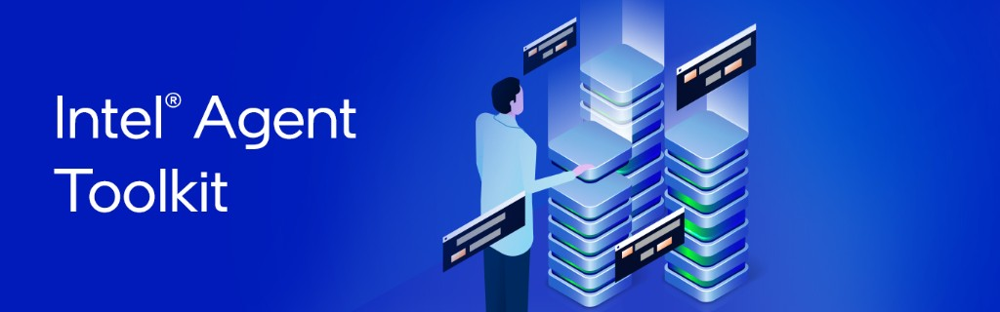

# Intel® Agent Toolkit documentation

  

The technical documentation for Intel® Agent Toolkit. Start with **Meet** for the what and why, **Get started** to stand it up, then **Deployment**, **Customize**, **Operate**, or **Reference** as you need them.

> [!IMPORTANT]
> Toolkit Manager installs and operates this toolkit. Clone **that** repository, run every command from its root, and `init agent-toolkit` will fetch this one into `ext/` for you. See [Meet](overview/meet.md).

## Meet

| I want to… | Page |
|---|---|
| Understand the stack and which repository to clone | [Meet the Agent Toolkit](overview/meet.md) |
| Get a short answer | [FAQ](faq-and-troubleshooting/frequently-asked-questions.md) |
| Look up a term | [Glossary](reference/glossary.md) |

## Get started

| I want to… | Page |
|---|---|
| Check hardware, SSH, DNS, and TLS before installing | [Prerequisites](getting-started/prerequisites.md) |
| Install on one host and call `/v1/chat/completions` | [Quickstart](getting-started/quickstart.md) |
| Call the gateway from a LangChain agent | [Build your first agent](getting-started/first-agent.md) |

## Deployment

| I want to… | Page |
|---|---|
| Install on one control plane plus workers | [Multi-node](deployment/multi-node.md) |
| Run containers on one Linux host, without Toolkit Manager | [Docker Compose](deployment/docker.md) |
| Tear the install down and install again | [Decommission](deployment/decommission.md) |

Behind a corporate proxy: [Corporate proxy](deployment/proxy.md). Related installs: [Inference Toolkit](https://github.com/intel/inference-toolkit) (`init inference`), [Chatbot Toolkit](https://github.com/intel/chatbot-toolkit) (`init erag`).

## Customize

Edit YAML under `env/local/` and re-run `install`.

| I want to… | Page |
|---|---|
| See which YAML file holds a setting | [Configuration](configuration/configuration.md) |
| Choose, size, or add a model | [CPU model configuration](configuration/xeon-models.md) |
| Screen each prompt before the main model | [Guardrails](configuration/guardrails.md) |
| Send a prompt to one of several models | [Routing](configuration/routing.md) · [Hybrid router](configuration/hybrid-router.md) (on by default) |

## Operate

| I want to… | Page |
|---|---|
| Check the cluster after install | [Validate the stack](faq-and-troubleshooting/validate.md) |
| Fix a failed install, API call, or pod | [Troubleshooting](faq-and-troubleshooting/troubleshooting.md) |

## Reference

| I want to… | Page |
|---|---|
| Copy Redis, pgvector, sandbox, and gateway URLs | [Backend connections](reference/backend-connections.md) |
| Run code the agent just generated | [Agent sandbox](reference/agent-sandbox.md) |
| Put a policy around that code | [OpenShell](reference/openshell.md) (off by default) |
| Run Ray jobs in the cluster | [KubeRay](reference/kuberay.md) (off by default) |

Guides not installed in this release: [Rack-scale](deployment/rack-scale.md), [Intel® Arc™ GPU](deployment/intel-arc.md), [vLLM semantic router](configuration/semantic-router.md). To report a bug or change the toolkit, see [Contributing](../CONTRIBUTING.md).

---

*Intel, the Intel logo, and Arc are trademarks of Intel Corporation or its subsidiaries.*
