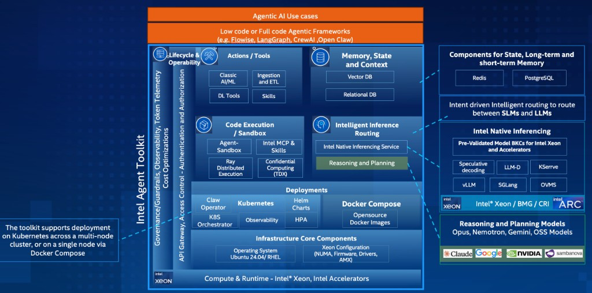

# Meet the Agent Toolkit

[← Docs index](../README.md)

Intel® Agent Toolkit is a layer for running production AI agents on Intel® Platforms. It provides the services a model endpoint does not: session and long-term memory, an Agent Sandbox, tool integration, and tracing.

You choose the models to serve on Intel® Platforms. [Toolkit Manager](https://github.com/intel/toolkit-manager) installs the cluster (for example Kubernetes), the model gateway, and this toolkit in one run. Agents built with LangGraph, CrewAI, Microsoft Agent Framework, OpenClaw, or any other agentic framework connect through standard interfaces: an OpenAI-compatible endpoint for model calls, Redis and PostgreSQL/pgvector for memory and state, and the Agent Sandbox. Existing agent code needs no rewrite: change the base URL and the credentials.

<p align="center">
  
</p>

## What is an agent in this stack?

An **agent** is an application that calls a language model and then acts on the result: it may query a database, execute generated code, or invoke an external API, then return that result to the model and continue.

In practice that loop looks like this:

1. The application sends a prompt to a language model through the gateway.
2. The model returns text, a tool call, or generated code.
3. The application (or the agent runtime) executes that action: a database query, a sandbox run, or an external API.
4. The result is sent back to the model, and the loop continues until the task is done.

Orchestration frameworks such as LangGraph, CrewAI, Microsoft Agent Framework, and OpenClaw implement steps 1, 2, and 4. This toolkit runs the production services that loop calls: model serving through the gateway, memory, the Agent Sandbox, and tools, and it keeps state between steps.

## Which repository to start from

Install from [Toolkit Manager](https://github.com/intel/toolkit-manager), not from this repository. `./toolkit_manager.sh` lives there: `init agent-toolkit` clones this repo under `ext/` and writes live config under `env/local/`. Edit those files; do not treat the YAML in this GitHub repo as the running config.

Toolkit Manager can also install [Intel® Inference Toolkit](https://github.com/intel/inference-toolkit) (`init inference`) and [Intel® Chatbot Toolkit](https://github.com/intel/chatbot-toolkit) (`init erag`).

For the first run, use [Prerequisites](../getting-started/prerequisites.md) and the [single-node quickstart](../getting-started/quickstart.md). For more than one host, use [multi-node deployment](../deployment/multi-node.md).

## What install brings up

A default install brings these parts up in order. Each part is configurable: you can bring your own cluster, pick the gateway and models, and switch individual toolkit components on or off. See [Configuration](../configuration/configuration.md).

| Part | What it deploys | How you confirm it |
|---|---|---|
| **Platform** | Cluster (for example Kubernetes), storage, service mesh, identity, Prometheus / Grafana | `kubectl get nodes` shows Ready |
| **Intel® Inference Toolkit** | Model serving (vLLM or another engine), LiteLLM or the AI gateway, Langfuse | `https://litellm.<base_domain_name>/v1/chat/completions` returns a completion |
| **Intel® Agent Toolkit** (this repository) | Redis, PostgreSQL with pgvector, Agent Sandbox, OpenShell, and KubeRay | Agents can store state and run actions off the host |

`./toolkit_manager.sh init agent-toolkit` followed by `install agent-toolkit` installs all three. The toolkit needs a cluster and model serving, so a successful install includes both a model API and the agent backends.

## Architecture deep dive

The numbered overview above is the product picture. The diagram below is the request path once the stack is running: the application calls the OpenAI-compatible gateway; behind it are model serving, memory, the sandbox, tools, and observability on the cluster (for example Kubernetes).

<p align="center">
  
</p>

## Toolkit components

The install and configuration guides use these names. Each component ships with a default implementation that you can run immediately; a component can be replaced later without rebuilding the rest of the stack.

| Component | Default | Role |
|---|---|---|
| **LiteLLM** | On (`auth_type: litellm_vkey`) | HTTPS gateway: one URL, virtual keys per app, OpenAI-compatible `/v1/chat/completions` |
| **Redis Stack** | On | Short-term memory: session state, caches, and RediSearch |
| **PostgreSQL + pgvector** | On | Long-term memory: embeddings, RAG, and data that persists across pod restarts |
| **Agent Sandbox** | On | Isolated pods for agent actions, off the host |
| **OpenShell** | Off | Policy layer on the Agent Sandbox. Set `openshell_enabled: true` at install |
| **KubeRay** | Off | Distributes Python tasks across worker pods. Set `kuberay_enabled: true` |
| **Keycloak realm** | On | Creates an `agent-toolkit` realm on the platform Keycloak (does not deploy Keycloak). Not required for the default LiteLLM path. Set `keycloak_agent_config_enabled: false` to skip it |
| **Langfuse** | On with LiteLLM | Trace UI for each LLM call: prompt, tokens, latency, and the model that served the request |

For Keycloak JWT on the AI gateway (`auth_type: jwt`), see [Configuration](../configuration/configuration.md).

## Deployment commands

After [Prerequisites](../getting-started/prerequisites.md):

```bash
./toolkit_manager.sh configure
./toolkit_manager.sh init agent-toolkit
# edit env/local/*.yaml: see Configuration
./toolkit_manager.sh install agent-toolkit
```

`init` copies this repository's defaults into `env/local/`. Edit that copy; do not treat the files in git as live configuration. Run `install` again to resume a failed install or to apply YAML changes: the toolkit roles (Redis, pgvector, sandbox, KubeRay, OpenShell) upgrade on every run.

## Request flow

1. The application calls `https://litellm.<base_domain_name>/v1/chat/completions` with a LiteLLM **virtual key** (create one after install; the master key is only for smoke tests and key admin). See [Build your first agent](../getting-started/first-agent.md).
2. LiteLLM authenticates the key. When guardrails are enabled, a safety model screens the prompt before the main model sees it.
3. The request is sent to the named model, or to a router that selects a model. See [Routing](../configuration/routing.md).
4. vLLM running on Intel® Platforms generates the completion.
5. If the agent then needs memory or code execution, it calls Redis, pgvector, or the sandbox **inside the cluster**. Those services are not exposed on the public gateway URL.

In-cluster URLs are listed in the [Backend connection reference](../reference/backend-connections.md).

## What this toolkit is not

This toolkit is not LangGraph, CrewAI, or LangChain. Those frameworks run on top of the toolkit and use its gateway, memory stores and sandbox through standard clients.

It is not a hosted model API. Models run on your hosts, on Intel® Platforms. A GPU is not required. You can still register a GPU or cloud endpoint (OpenAI, Anthropic, Gemini) on the same gateway later.

## Next steps

If this is the first time you are installing the stack, work through the pages in this order:

1. **[Prerequisites](../getting-started/prerequisites.md)**: hardware, SSH, DNS, and the TLS certificate.
2. **[Quickstart](../getting-started/quickstart.md)**: install on one host and send a chat request.
3. **[Configuration](../configuration/configuration.md)**: the YAML files under `env/local/` when you need to change the default layout.

The [glossary](../reference/glossary.md) defines the terms these pages use. The [FAQ](../faq-and-troubleshooting/frequently-asked-questions.md) answers the questions people ask after a first read. For more than one host, go to [multi-node deployment](../deployment/multi-node.md). After a chat completion succeeds, copy in-cluster URLs from the [backend connection reference](../reference/backend-connections.md), or tune [guardrails](../configuration/guardrails.md) and [routing](../configuration/routing.md).

---

*Intel, the Intel logo and Xeon are trademarks of Intel Corporation or its subsidiaries.*
